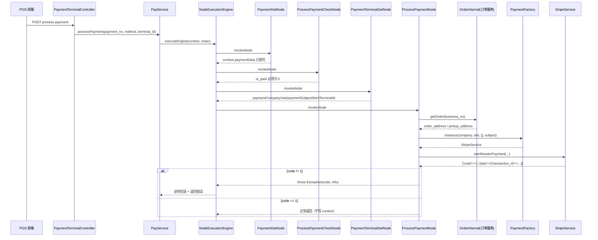

# Day 05 源码阅读笔记：ProcessPaymentNode（POS 读卡器触发支付）

> 对应课程：`week07/day05.md` ProcessPaymentNode 与类比日
> 源码映射：`week07/ProcessPaymentNode.php`（与真实仓库 `pay-service/common/services/pay/nodes/pay/ProcessPaymentNode.php` **逐字节一致**）
> 命名空间：`common\services\pay\nodes\pay`
> 依赖：`ProcessPaymentContext` / `PaymentFactory` / `OrderInternal` / `NodeExecutionEngine`
> 目标：看清这个节点到底读什么、写什么、失败时谁来兜底，以及它在整条 POS 支付链里的真实位置。

---

## 1. 一句话结论

`ProcessPaymentNode` 是 **POS 读卡器支付链的最后一环**，也是整条链里 **唯一真正打到第三方（Stripe Terminal）的节点**。

它做四件事，一共 20 行有效代码：

```text
读 Context（支付单 / 终端 / 渠道 / 主体）
  → 远程查订单（为了拿收货地址）
  → PaymentFactory 拿到渠道 Service
  → 调 startReaderPayment 下发刷卡指令
  → 非 1 就 throw，交回引擎中断
```

关键判断：**它是一个「薄分发节点」，不写 Context、不落库、不构造响应**。
真正复杂的东西（创建 PaymentIntent、回写 out_id、判断设备是否忙）全在 `StripeService::startReaderPayment()` 里。

这带来一个必须记住的副作用：**第三方返回的 `transaction_id` 被丢掉了**，接口对外只回 `[]`（见 §9.2）。

---

## 2. 它在链里的位置

### 2.1 入口到节点

```text
POST /payment-terminal/process-payment        （POS 端 / 门店端）
  ↓
PaymentTerminalController::actionProcessPayment
  │  校验 payment_no / payment_method / terminal_id 非空（否则 800000）
  ↓
PayService::processPayment($paymentNo, $paymentMethod, $terminalId)
  │  创建 ProcessPaymentContext
  │  paymentCompany = getPayChannelByMethod(paymentMethod)
  │  nodeChain = [...]
  ↓
NodeExecutionEngine::executeEngine($context, $nodeChain)
```

另一条同样入口：`storeapi/PaymentTerminalController::actionProcessPay`（门店子站），调用的是同一个 `PayService::processPayment`。

### 2.2 四节点链

| 顺序 | Node | 职责 | 失败码 |
|---|---|---|---|
| 1 | `PaymentGetNode` | 按 `payment_no` 查支付单，回填 `paymentData / paymentSubjectType / site / paymentId / transactionId / paymentSubject` | 700001 / 700002 / 3445623 |
| 2 | `ProcessPaymentCheckNode` | 只校验 `is_paid == STATUS_UNPAID(0)`；支付方式一致性校验**已被注释掉** | 7125806 |
| 3 | `PaymentTerminalGetNode` | 查 `payment_terminal`，回填 `paymentTerminal / paymentCompany / thirdTerminalId / site / paymentSubject` | 4110999 |
| 4 | **`ProcessPaymentNode`** | **调渠道 SDK 下发刷卡指令** | 720006 / 46681145 / 渠道码 |

注意两个「覆盖」关系，读代码时最容易漏：

- `paymentCompany` 在 `PayService::processPayment` 里由 **paymentMethod 推出**，随后被 `PaymentTerminalGetNode` 用 **终端表里的 `payment_company` 覆盖**。所以真正决定走哪个渠道 SDK 的，是**终端设备绑定的渠道**，不是请求里的支付方式。
- `site` / `paymentSubject` 同样被终端记录覆盖。

这解释了 `ProcessPaymentCheckNode` 为什么敢把「支付方式一致」校验注释掉：线下场景允许「线上创建的支付单，拿到 POS 机上刷」，渠道以设备为准。



---

## 3. 类结构与节点契约

```text
类名：ProcessPaymentNode
继承：\common\BaseNode（抽象类，要求实现 invokeNode / rollbackNode）
单例：BaseNode::instance() 走 Yii::$container 的 singleton
上下文：ProcessPaymentContext extends PayBaseContext extends BaseContext
```

`BaseContext` 提供：`controller / action / params / response / isStop`。
`PayBaseContext` 追加：`currency / currencySymbol / site / language / token / eid / pf / isTourist`。
`ProcessPaymentContext` 追加：

| 字段 | 来源 | 本节点是否使用 |
|---|---|---|
| `paymentData` | PaymentGetNode | ✅ 主数据源 |
| `paymentNo` | 入口参数 | ✅ |
| `paymentMethod` | 入口参数 | ✅ |
| `paymentCompany` | 终端表覆盖 | ✅ |
| `paymentId` | PaymentGetNode | ❌ 改用 `paymentData['payment_id']` |
| `transactionId` | PaymentGetNode（out_id） | ❌ 改用 `paymentData['out_id']` |
| `terminalId` | 入口参数 | ✅（系统内自增 id） |
| `thirdTerminalId` | 终端表（Stripe reader id） | ❌ 本节点不用，由渠道内部再查一次 |
| `paymentSubject` | 终端表覆盖 | ✅ |

**上下文里有现成字段却绕过它去读数组**（`paymentId` / `transactionId`），是这个文件第一个可读性瑕疵：同一份数据两个入口，日后只要一处口径变了就会错。

---

## 4. 逐行读（6 段）

### 4.1 前置守卫

```php
if (empty($context->paymentData)) {
    throw new \Exception('Payment not found', 720006);
}
```

- 正常链路里 `PaymentGetNode` 已经填过，这里基本是**防御式断言**。
- 只有「有人单独把本节点加进别的链」时才会命中。属于「防呆」，不是「业务校验」。
- 错误码 720006 与 `PaymentGetNode` 的 700001/700002 语义重叠，排障时要按 code 反查是谁抛的。

### 4.2 取第三方交易号

```php
$transactionId = $context->paymentData['out_id'] ?? '';
```

`out_id` = 已存在的第三方交易 ID（可能是上一轮 `startReaderPayment` 写回的 PaymentIntent id）。
`?? ''` 对「第一次支付」是正常情况。**但这个值在唯一实现里被丢弃**（见 §7.2）。

### 4.3 远程查订单

```php
$orderResult = OrderInternal::instance()->getOrder($context->paymentData['business_no']);
if (1 != $orderResult['code']) {
    throw new \Exception('Order not found', 46681145);
}
```

- `OrderInternal` 是跨服务 HTTP Wrapper（`GET http://order.internal.bm.com/order-query/get-order`），不是本地 SQL。符合「调其他域必须走 `common/api/`」的约定。
- **这里只为拿地址**：POS 刷卡需要把 `shipping_address` 传给 Stripe（部分地区/卡组织风控要求）。
- ⚠️ `BaseApi::get()` 内部 `catch (\Exception)` 后 **`return false`**。所以网络失败时 `$orderResult` 是 `false`，`false['code']` 在 PHP 7.4+ 触发 `Trying to access array offset on value of type bool` 警告，然后落到 `1 != null` → 抛 46681145。
  - 结果「正确」，过程「噪音」：订单服务超时被报成「订单不存在」，误导排障方向。
- ⚠️ 错误码 `46681145` 是裸魔法数，项目里没有枚举收录。

### 4.4 地址兜底

```php
$shippingAddress = !empty($orderResult['data']['order_address'])
    ? $orderResult['data']['order_address']
    : ($orderResult['data']['pickup_address'] ?? []);
```

先取配送地址，缺失则退回自提点地址。对「到店自提 + 现场刷卡」的门店场景是合理的。若两者都空 → 传 `[]` 给渠道，不报错、不拦截。

### 4.5 工厂 + 下发

```php
$result = PaymentFactory::instance(
        $context->paymentCompany,
        $context->paymentData['site'],
        [],
        $context->paymentSubject
    )->startReaderPayment(
        $context->paymentData['payment_id'],
        $context->paymentNo,
        $context->paymentData['currency'],
        $context->paymentData['pay_amount'],
        $context->paymentMethod,
        $context->terminalId,
        $shippingAddress,
        $transactionId,
        $context->paymentData['business_no']
    );
```

逐参数对照 `startReaderPayment` 签名：

| # | 形参 | 实参 | 说明 |
|---|---|---|---|
| 1 | `$paymentId` | `paymentData['payment_id']` | 内部支付单主键，用于回写 out_id |
| 2 | `$paymentNo` | `context->paymentNo` | 商城支付单号，进日志与第三方 metadata |
| 3 | `$currency` | `paymentData['currency']` | 来自支付单，非订单 |
| 4 | `$amount` | `paymentData['pay_amount']` | **来自支付单，未与订单金额二次比对**（见 §11-R3） |
| 5 | `$paymentMethod` | `context->paymentMethod` | 请求里的支付方式（此时可能是 `stripe_tap_to_pay`） |
| 6 | `$terminalId` | `context->terminalId` | **系统内自增 id**，渠道内部会再查一次换 `terminal_id` |
| 7 | `$shippingAddress` | 4.4 结果 | PII |
| 8 | `$transactionId` | `paymentData['out_id']` | 唯一实现中未使用 |
| 9 | `$orderNo` | `paymentData['business_no']` | 落第三方日志用 |

两处细节值得记：

1. **`site` / `currency` / `pay_amount` 都取自支付单快照**，不是实时订单。这是支付域正确做法（金额一旦进支付单就不该漂移），但要求创建支付单时金额已经锁定。
2. **`PaymentFactory` 只传了 4 个参数**，省略了 `$paymentMethod` 与 `$paymentSubjectType`，于是：
   - `paymentSubjectType` 取默认值 `TYPE_ONLINE(1)`；
   - 而 POS 终端在 `PaymentTerminalService` 里一律按 `TYPE_OFFLINE(2)` 配置主体。
   
   因为这里显式传了 `paymentSubject`（非空），`getPaymentSubjectInfo()` 走的是「按主体名直查」分支，所以**当前能拿到配置**；一旦终端记录的 `payment_subject` 为空，就会退化到「按 paymentMethod('' ) + TYPE_ONLINE 」查表 → 大概率为空 → `PaymentFactory` 返回 `null`（见 §11-R1）。这是「能用但很脆」的写法。

### 4.6 结果校验

```php
if (1 != $result['code']) {
    throw new \Exception($result['info'], $result['code']);
}
```

- 失败 → 抛异常 → 引擎捕获 → **中断后续节点 + 逆序回滚**。
- 成功 → **什么都不做**：不写 `response`、不写 `transactionId`、不写状态。

这就是 §1 说的「薄」，也是 §9.2 那个「数据被丢弃」问题的直接原因。

---

## 5. Context 读写表

| 方向 | 字段 | 用途 |
|---|---|---|
| 读 | `paymentData['payment_id']` | 传给渠道，用于回写 out_id |
| 读 | `paymentData['business_no']` | 查订单 + 落第三方日志 |
| 读 | `paymentData['out_id']` | 旧交易号（实际被渠道丢弃） |
| 读 | `paymentData['currency']` | 币种 |
| 读 | `paymentData['pay_amount']` | 金额 |
| 读 | `paymentData['site']` | 取渠道配置 |
| 读 | `paymentNo` | 支付单号 |
| 读 | `paymentMethod` | 支付方式 |
| 读 | `paymentCompany` | 选渠道 Service |
| 读 | `paymentSubject` | 取渠道配置 |
| 读 | `terminalId` | 找读卡器 |
| **写** | **无** | 只有 `throw` |

结论：`ProcessPaymentNode` 是**纯读取 + 副作用**节点。它的输出只有两种形态——**抛异常**或**静默成功**。
对比 `PaymentGetNode`（写 6 个字段）和 `PaymentTerminalGetNode`（写 5 个字段），可以直观看出「越靠近末端的节点，写 Context 越少」：因为末端之后已经没有消费者了。

---

## 6. 引擎怎么消费它的异常

`NodeExecutionEngine::executeEngine()` 关键逻辑：

```text
for 每个 node:
    try  invokeNode
        成功 → 记入 executedNodeList
    catch (\Exception $e)
        error = [code, message]; needRollBack = true
        对该 node 之前的节点 array_reverse 后依次 rollbackNode
        立刻 return ['code'=>错误码, 'data'=>错误信息, 'info'=>错误信息]
```

| 行为 | 后果 |
|---|---|
| 只 catch `\Exception` | PHP 7+ 的 `Error`/`TypeError`（例如对 `null` 调方法）**逃出引擎**，兜底靠 Controller 的 `catch (\Throwable)` → `endFail(0, 原始 message)`，把内部错误信息透给前端 |
| `data` 与 `info` 都塞 message | 上游只能拿到一句话，无结构化错误 |
| 每节点记耗时 | `g_log_info(controller/action/YmdH.log, ...)`，排障友好 |
| 最外层 `catch` 返回 9003 | 引擎自身异常统一 `Network error, please try again later` |

`ProcessPaymentNode` 作为**最后一个节点**，触发异常时引擎会回滚前面三个节点，但它们的 `rollbackNode()` 全是空实现——**回滚等于空转**。

---

## 7. 真正干活的地方：`StripeService::startReaderPayment`

节点只是分发，重磅逻辑在渠道层（`common/services/payment/StripeService.php`）：

```text
startReaderPayment(paymentId, paymentNo, currency, amount, method, terminalId, address, transactionId, orderNo)
  1. terminalId 为空 → returnError(4110240, 'Invalid terminal device')
  2. 再查一次 payment_terminal，取 terminal_id（Stripe reader id）
  3. isReaderInProgress(readerId)
       → retrieveReader(readerId) 查设备实时状态
       → action.status == 'in_progress' → returnError(4110247, '当前设备正在交易中…')
  4. createPaymentIntent({pay_amount, currency, payment_no, payment_method, shipping_address, order_no})
       → 失败原样返回
  5. PaymentRepository::updatePaymentById(paymentId, method, PAY_BY_STRIPR, intentId, terminalId)
       → 写 out_id / payment_method / payment_channel_company / terminal_id
       → 失败 returnError(4110241, 'Update transaction info failed')
  6. processReaderPayment(paymentNo, readerId, intentId, orderNo)
       → Stripe readers.processPaymentIntent
       → PaymentThirdpartyLogService 落第三方日志
  7. returnSuccess(['transaction_id' => intentId, 'no_paid_notify' => true])
```

### 7.1 三层防重的实际强度

| 层 | 机制 | 强度 |
|---|---|---|
| Controller | 无 Redis 锁 | ❌ |
| `ProcessPaymentCheckNode` | `is_paid == 0` | 弱（不变更状态，并发都能过） |
| `isReaderInProgress` | 查设备 `action.status` | 中（依赖第三方实时状态，有窗口期） |

对比 C 端 `PaymentController::actionPay` 有 `LockHandleRedis::paymentLocked(eid, 5)`，POS 这条链**入口没有加锁**。双击/重试会走到 `isReaderInProgress` 才被挡，而它在第 3 步才执行，此时第 3 步之前并无写操作，所以**重复 PaymentIntent 的风险主要来自两次请求都卡在第 3 步之前**——压力不大但理论存在。

### 7.2 一个被无视的参数

`startReaderPayment` 收了 `$transactionId`，但实现里第 4 步之后直接 `$transactionId = $createResult['data']['id'];` **覆盖掉**。
也就是说 `ProcessPaymentNode` 传进来的第 8 个参数是**死参数**。
这暗示设计曾经想支持「重放已有 intent」，现在退化为「每次新建 intent」。

### 7.3 其他渠道会不会爆

`DefaultPaymentService::startReaderPayment()` 返回 `returnError(550128, '暂不支持')`。
所有渠道（Braintree / Paypal / Klarna / OtherPay…）都继承自它，所以**非 Stripe 终端会优雅报错**，不会崩。
但注意：`PaymentInterface` **没有声明** `startReaderPayment`（只声明了 `processReaderPayment / cancelReaderPayment` / `verifyCredential` 等），而 `PaymentFactory::instance()` 的 docblock 写着 `@return PaymentInterface`。**契约与实际能力不符**，静态分析帮不上忙。

---

## 8. 错误码速查

| code | 来源 | 含义 | 前端该做什么 |
|---|---|---|---|
| 800000 | Controller | 参数缺失 | 提示补参 |
| 700001 / 700002 | PaymentGetNode | payment_no 空 / 支付单不存在 | 检查支付单 |
| 3445623 | PaymentGetNode | 支付参数不存在 | 重新发起 |
| 7125806 | ProcessPaymentCheckNode | 支付单已支付/状态不允许 | 刷新状态 |
| 4110999 | PaymentTerminalGetNode | 终端设备不存在 | 检查设备绑定 |
| **720006** | **本节点** | paymentData 为空（断言） | 几乎不会出现 |
| **46681145** | **本节点** | 订单服务返回非 1（含超时被误判） | 提示订单不存在 |
| 4110240 | StripeService | terminalId 为空 | 检查设备 |
| 4110247 | StripeService | 设备正在交易中 | 换设备/稍后重试 |
| 4110239 | StripeService | 下发指令超时 | 可重试 |
| 4110241 | StripeService | 回写 out_id 失败 | 查库 |
| 550128 | DefaultPaymentService | 该渠道不支持读卡器 | 换支付方式 |
| 9003 | Engine | 引擎内部异常 | 稍后重试 |

---

## 9. 失败与语义问题

### 9.1 回滚是空的，而且回滚不了

`rollbackNode($context) {}` 空实现。这在设计上可接受，因为：

- 本节点是链尾，没有「已执行的后续节点」需要补偿；
- 第三方已下发刷卡指令**无法用本地事务撤销**。

但确实存在的副作用窗口：

```text
第 4 步 createPaymentIntent 成功（intent 已建）
  ↓
第 5 步 updatePaymentById 失败
  ↓
节点 throw 4110241
  ↓
引擎回滚 → 全部空实现 → 什么都不发生
  ↓
结果：Stripe 侧有孤儿 intent；本地 out_id 没写；设备可能进入 action=in_progress
  ↓
下一次请求在 isReaderInProgress 被挡 4110247 直到 intent 超时
```

**正确的补偿是**：在 `rollbackNode()` 里调 `cancelReaderPayment()` / 取消 intent。现在没有任何地方做，只能靠 Stripe 侧超时自愈。这是本节点最值得写进「改进清单」的一条。

### 9.2 渠道返回的数据被丢掉

```text
Stripe 返回：['code'=>1, 'data'=>['transaction_id'=>'pi_xxx','no_paid_notify'=>true]]
节点：只判断 code，data 丢弃
PayService::processPayment：returnSuccess($context->response)  → response 仍是 []
Controller：endSuccess([], '发起支付成功')
```

后果：

- 前端拿不到 `transaction_id`，无法立即查询订单/支付单状态，只能轮询或等 webhook；
- `no_paid_notify` 这个「先不要通知订单成功」的信号在 POS 链里彻底丢失。
  对比 C 端支付链（`PayService.php:638` 读 `$createResult['data']['no_paid_notify']`），说明这个字段在别的链上是**被消费的**——POS 链漏了。

最小修法：`$context->response = $result['data'] ?? [];` 一行。

### 9.3 「订单存在」不等于「可以支付」

本节点只确认 `OrderInternal` 返回 `code == 1`，**不校验**：

- 订单状态是否待支付（是否已被取消/关闭/已支付）；
- 订单归属门店是否与 `terminal_id` 的 `affiliated_store` 一致；
- 订单金额是否等于 `paymentData['pay_amount']`。

前两项由 `ProcessPaymentCheckNode` 的 `is_paid` 部分覆盖，第三项**全链无人校验**。金额以支付单为准可以接受，但前提是「支付单金额来自可信下单快照」。若存在「线下改价」场景，这里就是缺口。

### 9.4 异常类型

`throw new \Exception($result['info'], $result['code'])` 用的是 `$result['info']`，即渠道原始文案（英文）。Code 直接透传第三方约定码，前端需要能区分业务码段（7xxxxxx / 41xxxxx / 55xxxx）。

---

## 10. 敏感字段与日志

| 数据 | 是否出本节点 | 风险 | 现有处理 |
|---|---|---|---|
| `shipping_address`（姓名/电话/地址） | ✅ 传给 Stripe | PII | 渠道层 `g_log_info` 会打印 `createData`，**未脱敏** |
| `out_id` / `transaction_id` | ✅ | 中（可关联第三方） | 落 `payment` 表 + 第三方日志表，正常 |
| `paymentData`（含金额、站点、主体） | 不打印 | — | 引擎首行 `log($context,'开启节点执行引擎', $context)` 会序列化整个 Context，但发生在 `PaymentGetNode` **之前**，此时 `paymentData` 还空 |
| 卡号 / CVC | ❌ 本链不接触 | — | 由终端读卡器直连 Stripe，服务端不过手（设计正确） |
| Stripe secret key | 不经过节点 | 高 | 只在 `StripeService::__construct` 里读 config；`privateKey` 是 public 属性，勿外传 |

补充：Controller 打日志 `g_log_info('payment_terminal', '触发支付参数', [$params])` 只含三个非敏感参数，OK。

---

## 11. 风险清单（按严重度）

| # | 级别 | 问题 | 证据 | 建议 |
|---|---|---|---|---|
| R1 | 高 | `PaymentFactory::instance()` 可能返回 `null`，本节点直接链式调用 → PHP `Error` | 节点未判空；`getPaymentChannelConfig` 在「主体为空且查不到配置」时 `return null` | 判空后 `throw new \Exception('Payment channel unavailable', 700007)`（对齐 `PayService:487`） |
| R2 | 高 | 引擎只 `catch (\Exception)`，`Error` 逃逸到 Controller 的 `catch (\Throwable)` → `endFail($e->getCode()=0, 内部 message)` | `NodeExecutionEngine` 内外两层均 `catch (\Exception)` | 引擎改 `\Throwable`；或本节点保证只抛 `\Exception` |
| R3 | 中 | 订单金额未与支付单金额比对 | 全链无此校验 | 在 `ProcessPaymentCheckNode` 增加比对 |
| R4 | 中 | 渠道返回 `data`（`transaction_id` / `no_paid_notify`）被丢弃，接口回空 | 节点不写 `context->response` | `$context->response = $result['data'] ?? []` |
| R5 | 中 | 建 intent 成功但回写失败时，无补偿，产生孤儿 intent + 设备忙 | `rollbackNode` 为空 | 在 `rollbackNode` 调 `cancelReaderPayment` |
| R6 | 中 | POS 链入口无 Redis 防重锁（C 端有） | 两个 Controller 均无 `paymentLocked` | 入口加 `terminalId` 维度锁 |
| R7 | 中 | `paymentSubjectType` 用默认 `TYPE_ONLINE`，与终端 `TYPE_OFFLINE` 不一致 | 工厂只传 4 参 | 显式传 `$context->paymentSubjectType` 或终端类型的常量 |
| R8 | 低 | 订单服务超时被报成「订单不存在」+ PHP 数组偏移警告 | `BaseApi::get()` return false | 先 `is_array` 判断，区分 46681145 / 系统繁忙 |
| R9 | 低 | `paymentId` / `transactionId` 绕过 Context 字段直接读 `paymentData` | §3 表 | 统一改读 Context |
| R10 | 低 | `PaymentInterface` 未声明 `startReaderPayment`，但工厂 docblock 声称返回该接口 | 接口文件无此方法 | 补进接口（含 `DefaultPaymentService` 的默认实现） |
| R11 | 低 | 魔法错误码 720006 / 46681145 无枚举 | 代码直写 | 收进业务字典 |
| R12 | 低 | `site` 用 `paymentData['site']`，而 `context->site` 已被终端覆盖，两处口径不同 | §2.2 | 统一取终端 `site` |

> 读这份清单的方法：**R1/R2 是「会 500/暴露内部信息」的**，R3/R4 是「业务语义错」的，R5/R6 是「运维偶发」的。优先级按这个顺序。

---

## 12. 与课程模板的差异（重要）

`day05.md` 里的模板假设 `ProcessPaymentNode` 是「通用支付节点，调 `createPayment`、写 `client_secret`」。**真实源码不是这样**：

| 课程模板假设 | 真实源码 |
|---|---|
| 调 `createPayment` 拿 `client_secret` | 调 `startReaderPayment` 下发 **POS 读卡器**刷卡指令 |
| 写 `third_transaction_id` / `client_secret` 到 Context | **不写任何字段**，`transaction_id` 由渠道层直接落 `payment.out_id` |
| 失败返回 `NodeResult::fail()` | **抛 `\Exception`**，由引擎捕获 |
| 校验订单金额/归属 | 只校验「订单接口返回 code==1」 |
| `BuildResponseNode` 消费本节点产物 | 链里**没有** BuildResponseNode；`PayService` 直接返回 `context->response`（空） |

保留部分：**「Context 是共享数据容器」「节点失败即中断」「Express middleware 类比」**这三条结论依然成立，而且比模板更极端——本节点证明「末端节点可以只读不写」。

---

## 13. Node.js 类比

```js
// 引擎 ≈ 一个同步有序的 middleware runner，但只 catch 常规错误
async function executeEngine(ctx, chain) {
  const executed = [];
  for (const node of chain) {
    try {
      await node.invokeNode(ctx);
      executed.push(node);
    } catch (e) {
      for (const n of executed.reverse()) {
        try { await n.rollbackNode(ctx); } catch (_) {}
      }
      return { code: e.code, data: e.message, info: e.message };
    }
  }
  return { code: 1, data: null, info: 'success' };
}

// ProcessPaymentNode ≈ 一个只读 ctx、调外部 SDK 的 step
async function processPaymentNode(ctx) {
  if (!ctx.paymentData) throw Object.assign(new Error('Payment not found'), { code: 720006 });
  const order = await orderInternal.getOrder(ctx.paymentData.business_no);
  if (order.code !== 1) throw Object.assign(new Error('Order not found'), { code: 46681145 });
  const address = order.data.order_address || order.data.pickup_address || {};
  const channel = paymentFactory.instance(ctx.paymentCompany, ctx.paymentData.site, [], ctx.paymentSubject);
  const result = channel.startReaderPayment(/* 9 个位置参数 */);
  if (result.code !== 1) throw Object.assign(new Error(result.info), { code: result.code });
  // 注意：这里什么都没写回 ctx —— 等价于 middleware 调完 SDK 却不 res.locals 任何东西
}
```

| PHP | Node.js 等价物 | 差异点 |
|---|---|---|
| `NodeExecutionEngine` | 手写 for + try/catch（koa-compose 风格） | 只 catch `\Exception`，等价于只 catch `Error`，**不 catch `TypeError` 之外的异常体系差异**在 JS 里不存在，反而更安全 |
| `ProcessPaymentContext` | `ctx` / `req.context` | PHP 是类属性集合，写入靠属性名，无 schema |
| `invokeNode` 抛异常 | `throw` → `next(err)` | 一致 |
| `rollbackNode` | 无标准对应，接近 saga 的 compensate | 空实现等于放弃补偿 |
| `PaymentFactory::instance()` | `handlers[channel]` | 返回 `null` 而不是抛错 → JS 里 `?.` 会静默，PHP 会硬崩 |
| 9 个位置参数 | 对象参数 `{paymentId, paymentNo, ...}` | 位置参数是本节点最易错的地方 |

---

## 14. 自测题（附简答）

1. **`ProcessPaymentNode` 从 Context 读哪些字段？**
   `paymentData`（payment_id / business_no / out_id / currency / pay_amount / site）、`paymentNo`、`paymentMethod`、`paymentCompany`、`paymentSubject`、`terminalId`。

2. **它往 Context 写什么？**
   什么都不写。成功就静默返回，失败就 `throw`。

3. **为什么它要查订单？**
   为了拿 `order_address`（缺失时退回 `pickup_address`）传给 Stripe 读卡器支付。

4. **`paymentCompany` 到底由谁决定？**
   `PaymentTerminalGetNode` 从 `payment_terminal.payment_company` 覆盖，即**终端设备绑定的渠道**，不是请求里的支付方式。

5. **渠道返回成功，前端能拿到 `transaction_id` 吗？**
   不能。节点丢弃了 `$result['data']`，`context->response` 为空，接口返回 `[]`。

6. **失败会回滚什么？**
   引擎逆序调用前 3 个节点的 `rollbackNode`，而它们全是空实现。真正需要的补偿（取消 Stripe intent）**没人做**。

7. **`PaymentFactory` 返回 `null` 会怎样？**
   对 `null` 调 `startReaderPayment` 抛 PHP `Error`；引擎只 catch `\Exception` 接不住，最终在 Controller 的 `catch (\Throwable)` 变成 `endFail(0, 原始 message)`。

8. **非 Stripe 终端走这条链会怎样？**
   `DefaultPaymentService::startReaderPayment` 返回 `550128 暂不支持`，节点抛异常，前端收到明确错误。

9. **为什么 `ProcessPaymentCheckNode` 把「支付方式一致」校验注释了？**
   因为线下支持「线上建单、POS 刷」，渠道以终端为准。

10. **这个节点算过重吗？**
    不算。20 行、单一职责、不写库不拼响应。真正重的是 `StripeService::startReaderPayment`（7 步、2 次外部调用、1 次写库）。

---

## 15. 20 分钟复盘练习

- [ ] 白板画出四节点链，标出每个节点写了 Context 的哪些字段
- [ ] 口述 `StripeService::startReaderPayment` 的 7 个步骤，指出哪一步失败会留下孤儿 intent
- [ ] 在源码里标出 `startReaderPayment` 的 9 个参数分别来自哪里
- [ ] 说出「为什么 POS 链入口没有 Redis 锁仍能基本防重」以及它的薄弱点
- [ ] 给出让前端拿到 `transaction_id` 的一行改动
- [ ] 用 Express middleware 讲一遍，并说明「调完 SDK 不写回 ctx」为什么是 bug

---

## 16. 最终复盘句

`ProcessPaymentNode` 的价值不在它自己写了什么，而在它**证明了一件事**：
Node 链可以把「取数据 / 校验 / 选渠道 / 打第三方」彻底切开，末端节点可以薄到只剩 5 行转发。

代价是**末端节点的输出必须被后续消费**。这里断在了最后一步——渠道明明返回了 `transaction_id` 和 `no_paid_notify`，却被静默丢弃，`rollbackNode` 也放弃了补偿。
所以读这类「薄节点」，真正要盯的不是节点内的 if/else，而是三件事：
**返回值有没有人接、异常有没有人接、副作用有没有人撤销。**
